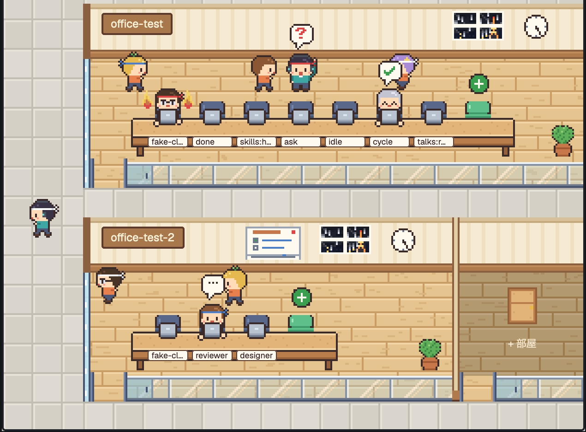

# Herdr AI Office

English | [日本語](README.md)

A mod and layout for [Herdr](https://herdr.dev) (herdr-app) that shows your spaces as rooms and your AI agents as characters in a
Kairosoft-style pixel-art office. All the art was drawn for this repository.



- One space = one room, one agent = one character. Characters act out their agent's state: typing while it works, walking to the
  library's bookshelf while it looks things up, raising a hand when it has a question or needs permission, a ✓ when it's done, and
  wandering around when it's idle
- Click a character, nameplate or laptop to show that agent's terminal (over the office while the terminal on the right is
  hidden). It's the real terminal, so you can talk to the agent right there
- Click a free seat to hire an agent, and the "+ Room" door to make a room (space)
- Plans and .md files the agents write go up on their room's whiteboard; the skills you can use stand on the library's bookshelf
- The wall clock and the view out of the window follow the time and weather of a city you pick
- English and Japanese (follows the OS; pick one with the globe button at the top right)

## Before you install: what the office touches

Herdr mods are trusted code, so here is what this one does beyond drawing:

- **Network**: fetches the weather for the window from [Open-Meteo](https://open-meteo.com/) (no key; it sends only the chosen
  city's latitude and longitude, every 15 minutes)
- **Runs programs**:
  - `sh`: at start, to read the OS language (`defaults read -g AppleLanguages` on macOS, `LANG` and the like elsewhere)
  - `herdr-app status`: when you press ⌘⇧., to see whether something is shown over the office
  - `git rev-parse`: when you open a room's menu, to see whether its folder is a worktree
  - `hc read` and `hc keys`: when you answer a question from the "?", to read the terminal's screen and send the answer's keys
- **Reads files outside its folder** (never writes them):
  - Skills: `~/.claude/skills/`, plugin skills and commands (where `~/.claude/plugins/installed_plugins.json` points),
    `~/.codex/skills/`, and `.claude/skills/` in each space's folder
  - Model and effort: `~/.codex/config.toml`, and `~/.cache/claude-model/` and `~/.cache/claude-effort/` if they exist
  - The plans and .md files the agents wrote (the paths the hook put in terminal labels)
  - Themes you add: `~/.config/herdr-app/ai-office-themes/`
- **What `scripts/install.sh` changes**:
  - `mods/` and `layouts/` in `~/.config/herdr-app/` (copies this repository's mods and layouts there)
  - `~/.claude/settings.json`: adds the Claude Code hook (`--no-hook` skips it)
  - `~/.config/herdr-app/keys.json`: adds two keys (`--no-keys` skips it; the first time it changes the file, it keeps the
    original as `keys.json.before-ai-office`)
- **What the hook writes**: labels (`office.*`, through `hc label`) on the terminal Claude Code runs in, and small records in
  `$TMPDIR`

## Install

You need herdr-app (with the `hc` that comes with it), `jq` and `rsync` (macOS has it). The tests need `bun`; redrawing the art
needs `uv`.

```sh
git clone https://github.com/thundermiracle/herdr-ai-office.git
cd herdr-ai-office
scripts/install.sh                            # copies the mods and layouts, registers the hook, adds the keys, checks
herdr-app do layout.switch --name ai-office   # switch to the office layout (ctrl-shift-l works too)
```

- To update: `git pull && scripts/install.sh`. A layout is copied only when it's missing or different
- `install.sh` ends with `scripts/doctor.sh`, which checks your setup; an NG line says how to fix it
- When the hook is newly registered, restart the Claude Code sessions that are running (Claude Code uses the hooks it started with)
- The hook points at the repository's folder, so run `install.sh` where you cloned it (and again if you move the repository)
- `--no-hook`: don't register the hook. Rooms, characters, typing, raised hands and ✓ still work; trips to the library, skills,
  the whiteboard and talking to other agents don't
- `--no-keys`: leave keys.json alone (⌘. and ⌘⇧. won't work). Once keys.json is changed, Herdr no longer adds its new default
  shortcuts to it when it updates

To uninstall (switch to another layout first):

```sh
herdr-app do layout.switch --name main   # Herdr's default layout
hooks/register.sh remove                 # remove only this Claude Code hook (other hooks stay)
scripts/keys.sh remove                   # remove only the keys it added
rm -r ~/.config/herdr-app/mods/ai-office ~/.config/herdr-app/mods/ai-office-*
rm ~/.config/herdr-app/layouts/ai-office.json
```

## Use

```sh
herdr-app do layout.switch --name ai-office   # the office on the left, the terminal of the agent you clicked on the right
herdr-app do mod.open --name ai-office        # open it as a floating window over the current layout (again to close)
scripts/demo.sh start                         # a demo: spaces of fake agents (no AI involved); stop removes them
```

You can also add an office column to your own layout, shown and hidden with an "Office" button next to the tab bar
(`ai-office-toggle`; how to add it is in [docs/internals.md](docs/internals.md), in Japanese).

### The top bar

On the left, the counts (working, waiting, done, idle; while you drag a room, what dropping it will do). The buttons on the right:

| Button | What it does |
|---|---|
| Theme: … | Picks the look of the rooms (see Themes below) |
| Terminal: shown / hidden | Shows or hides the terminal on the right. Hidden, the office fills the window, and the terminal of the agent you click shows over the office (ai-office layout only) |
| Toasts: on / off | Whether toasts (an agent waiting, done and so on) show at the bottom right. Sounds still play (they're in Herdr's Settings > Alerts) |
| Legend | How to tell the characters apart (AI and model, effort headbands) |
| The globe | The language (see Language below) |

Your theme, toast and language choices live in Herdr's shared state, so they survive a restart and every open office follows them.

### Clicks

| Where | What happens |
|---|---|
| A character, desk nameplate or laptop | Shows that agent's terminal (switches to it when the terminal on the right is shown, shows it over the office when hidden). A "!" waiting for permission, or an agent stopped at a check before it starts, can be answered right there |
| Right-click a laptop | That tab's menu (Rename, Close) |
| A question's "?" | A dialog with the question and its choices. Picking one sends the answer to the terminal (↑↓ and Enter, 1–9, Esc closes). Follow-up questions too, up to the final review |
| A free chair and the "+" above it | Starts the agent you pick in a new tab of that room |
| The "+ Room" door | Pick a folder to make a new space (room) |
| A room's nameplate on the wall | Selects that space and opens the room's menu (Rename, worktrees, Close). Drag a room's back wall to change the order of the rooms (spaces) |
| A whiteboard | Read the plans and .md files the room's agents wrote, as Markdown |
| The library's bookshelf | The list of skills you can use; click one to read it |
| The wall clock | Pick the city (time zone); the clock, the sky and the weather follow it |
| A window (hover) | That city's time, weather and temperature |

### Keys

| Key | What it does |
|---|---|
| ⌘. (Command + period) | Closes the terminal shown over the office (Esc goes to the agent, so it can't close it; ✕ closes it too) |
| ⌘⇧. (Command + Shift + period) | Opens the last agent you opened from the office again (ai-office layout only; does nothing while something is shown over the office) |

`install.sh` adds both from the repository's `keys.json` to Herdr's keys.json (`scripts/keys.sh add`: it adds only missing keys,
and if you already use a key for something else, it leaves it and tells you). `scripts/keys.sh status` shows whether they're there.

### What the characters do

| Agent's state | What the character does |
|---|---|
| working (editing, running commands) | Types on the laptop at its desk |
| working, looking things up (Read, Grep, web search; the hook tells the office) | Walks down the hall to the library and reads a book |
| used a skill (hook) | Hurries to the library, pulls out that skill's book, reads it and comes back |
| talked to another agent with `hc send` (hook) | Hurries over to them, talks with a tag showing what it sent, and comes back |
| blocked (a question, or waiting for permission) | Raises a hand behind its chair: "?" for a question, "!" for permission |
| hasn't reported a status yet (starting up, or stopped at a check before it starts) | Stands behind its chair; after 3 seconds without a report, raises a hand with a "!" |
| done (finished while you weren't looking) | A "✓" at its desk |
| idle | Stands and wanders around |

Each AI has its own look (Claude Code wears an orange jacket, Codex a teal jacket and headphones, any other AI a purple jacket);
hair and accessories tell the model, the headband tells the effort (the Legend button shows this too):

| Model (hair and accessories) | Effort (headband) |
|---|---|
| opus: dark brown hair, glasses, a tie | low: none |
| sonnet: brown hair (also when the model isn't known) | medium: blue |
| haiku: blond hair, a green leaf | high: white |
| fable: lilac hair, a star pin | xhigh: red |
| Codex: black hair, headphones | max: red, with flames on both sides while working |

The model and effort come from the command line (`--model` and `--effort` for Claude Code, `-m` and
`-c model_reasoning_effort=` for Codex) or `~/.codex/config.toml`. If you change them in the middle of a Claude Code session, the
office sees it when something like a statusLine script writes them to `~/.cache/claude-model/<session>` and
`~/.cache/claude-effort/<session>` (the session is the terminal's `resume.id` label; details in
[docs/internals.md](docs/internals.md)).

## Language

The office (buttons, tooltips, dialogs) is in English and Japanese. It starts in the OS language (on macOS, the top of
Language & Region; elsewhere `LC_ALL`, `LC_MESSAGES` or `LANG`; read when the office starts). The globe button in the top bar
picks "Match the OS", English or 日本語. With any other OS language, it's English.

- The tab and room menus (Rename, Close and so on) and the toasts stay in English, like Herdr's own
- The scripts (`install.sh`, `doctor.sh` and so on) print Japanese only
- A theme's name and description can be written per language in its `theme.json` (see Adding a theme below)

To add a language, add a table under the same names as `en` to `TEXT` in `mods/ai-office/text.js` and to the `TEXT` of each other
mod (`mods/ai-office-*/main.js`), and add the language's own name for itself to `LANGS` in `text.js`. `bun test` checks that every
language has every sentence English has.

## The details

- **Library bookshelf**: one book = one skill you can use, colored by where it comes from (blue: `~/.claude/skills`, red:
  `.claude/skills` in a space's folder, orange: synced from claude.ai, green: plugins, teal: Codex). Up to 39 stand on the shelf;
  the rest are only in the list. Skills built into Claude Code (`/code-review` and so on) have no files, so they aren't there
- **Whiteboard**: when someone in a room writes a plan (Claude Code's plan mode) or a .md file (Write, Edit, or Bash with
  `> x.md`, `cp`, `mv` and so on), a whiteboard goes up on that room's wall. Several show as a list on the left, and an open one
  is read again every 2 seconds. Instructions and settings for agents (`CLAUDE.md`, `AGENTS.md` and so on) and anything inside
  `node_modules/` and the like stay off. Entries stay until the session ends
- **Talking to another agent**: when an agent sends another one a message with `hc send <to> "text"`, it walks over and they talk,
  with a tag showing what it sent and a "…" from the other one, then it walks back (visible when the sender or the receiver is
  Claude Code with the hook)
- **Wall clock and window**: pick one of 19 cities (at first, the one closest to your Mac's time zone). The sky follows the sun —
  night, twilight, dawn, day, dusk — with each city's landmark in view (Tokyo Tower, the Eiffel Tower and so on). The weather can
  be clear, cloudy, fog, rain, snow or a thunderstorm. Try one with `scripts/sky.sh rain night`, and go back with
  `scripts/sky.sh auto`
- **Toasts**: "Toasts: off" works only in layouts whose outermost node has `"toast": "ai-office-toast"` (`ai-office` and the
  like). While it's off, error toasts and mods' `notify()` don't show either. `herdr-app do ai-office.toasts-off`
  and `toasts-on` switch it too

The fine print is in [docs/internals.md](docs/internals.md) (in Japanese).

## The Claude Code hook

`hooks/claude-office-act.sh` writes the tool Claude Code is about to use, the skills it used, the plans and .md files it wrote and
whom it talked to into labels on its terminal (`office.act`, `office.skill`, `office.plan`, `office.docs`, `office.talk` and so on).
That tells the office what the state alone (working and so on) can't. It runs only inside Herdr's terminals (when `HC_TERMINAL_ID`
is set) and takes 30–40 ms a call.

```sh
hooks/register.sh status   # is it registered in ~/.claude/settings.json?
hooks/register.sh add      # register it (PreToolUse, UserPromptSubmit, Stop, SessionEnd; install.sh runs this)
hooks/register.sh remove   # remove only this hook (other hooks stay)
```

Codex has no hook yet (a Codex agent only sits, wanders, raises a hand and shows ✓).

## Themes

Pick one with Theme in the top bar. Two come with the office:

| | Modern (the default) | Japanese (folder: classic) |
|---|---|---|
| Rooms | Separate rooms with a glass wall and an automatic door on the hall side | Tatami rooms with shoji walls and a shoji door on the hall side |
| Floors and halls | Wooden floors, stone-tiled halls | Tatami, an engawa veranda and wooden halls |
| Desks and chairs | Desks and chairs | Low tables and floor cushions |
| Windows | Sliding windows with aluminum frames | Sliding windows with wooden frames |

### Adding a theme

A theme is a folder (`theme.json` and PNGs), named after the theme. Put yours in `~/.config/herdr-app/ai-office-themes/<name>/`
(`install.sh` leaves it alone; it wins over a bundled theme of the same name). The office reads themes when it starts, so after
adding one, run `scripts/sync.sh ai-office` or reopen Herdr. `bun scripts/check-theme.js <folder>` runs the office's own checks
(and says why when a theme can't be used; the office shows that under the Theme dropdown).

```jsonc
// mods/ai-office/themes/modern/theme.json (all numbers in art px; the office draws 1 art px as 2 logical px)
{
  "label": { "en": "Modern", "ja": "モダン" },  // the name in "Theme: …"; a plain string works too (per language: the current one, else English)
  "description": { "en": "…", "ja": "…" },      // the tooltip's description (written like label)
  "order": 1,                        // order in the dropdown (smallest first; same order: by name)
  "window": "slide",                 // wall window: slide (two sliding panes), wood (wooden sliding frame), cross (crossed bars); default cross
  "room": {
    "height": 116,         // the height of a row (the rooms and the hall or aisle in front of them)
    "wall": 30,            // the back wall's height (same as the wall image's)
    "lane": 48,            // the aisle behind the desks (where feet go); below the wall, above the chairs (deskBack − 9)
    "deskBack": 62,        // the desks' back edge (desks are 21 tall)
    "box": 100,            // the room frame (the selected room's frame, the drag marks); for a glass room, the glass's bottom
    "corridorY": 112,      // where people walk when they leave the room (feet)
    "wanderFront": null,   // the y range [top, bottom] to wander in front; null for a glass room (inside the room only)
    "rightExit": false,    // whether people also leave by the aisle right of the desks (only rooms open at the front)
    "partitionEnd": 100,   // how far from the back the room's left partition (wall) runs
    "hallSide": "glass",   // the left wall facing the vertical hall: glass or partition
    "shelfY": 8,           // the top of the library's bookshelf
    "decorDy": -2          // moves the wall decorations (window, clock, whiteboard) up or down
  },
  "glass": { "y": 86, "height": 14 },  // the front wall (glass; shoji in the Japanese theme); null for rooms open at the front
  "images": {                          // PNGs in this folder; anything not named uses img/'s default (wall 36, floor, hall)
    "wall": "wall.png",                // the back wall (tiled)
    "corridor": "corridor.png",        // each row's corridor floor (height − box tall)
    "glass": "glass.png",              // one pane of the glass wall (tiled; glass.height tall)
    "door": "glass-door.png",          // the door frame: left post 2, doorway 16, right post 2 (glass.height + 2 tall)
    "doorPanel": "glass-door-panel.png" // the automatic door (16+ wide, up to glass.height tall); without it the door stays open
  },                                   // floor, hall, desks (desk-l, desk-m, desk-r) and chairs (chair, chair-free) can change too
  "colors": {}             // partition and glass wall colors (partition, partitionEdge, partitionFace, partitionBase, sideGlass, sideGlassEdge)
}
```

- The // lines explain; a real theme.json is JSON and can't have comments
- Draw PNGs at 4 px per art px (sizes are read from the PNGs). For 1.5× and 2× drawing you can add 6× and 8× PNGs named with
  `@6x` and `@8x` (otherwise the 4× PNG is stretched and blurs a little)
- Desks are the same size as img/'s (ends 8 x 21, one seat 24 x 21). The chair and the free seat's chair are the same size, at
  most 24 wide
- A theme changes sizes, the floor, wall, hall, glass, door, desk and chair images, the partition colors and the window frame.
  How desks are laid out and how people walk stay the same

## Troubleshooting

Run `scripts/doctor.sh` (it changes nothing and doesn't move your screen). It checks the tools and jq's version, the hook's
registration and behavior, whether the installed mods match the repository, Herdr's errors, the keys in keys.json and what would go
on the whiteboards now, and an NG line says how to fix it. Its output is in Japanese.

## Known limits

- Built and tested on macOS (not tried on other systems)
- The art is 4× PNGs drawn at 2 logical px, so a Herdr zoom other than 1 blurs it a little
- One timer steps the animation (4 fps while the window is active, 2 fps behind other windows). Herdr's CPU use is about 5–8%
  while the office shows and about 1% while it's hidden
- Library trips, skills, whiteboards and talking show only for Claude Code sessions started after the hook was registered; not
  for Codex or sub-agents
- Sub-agents (terminals without a pane, started with `hc run`) aren't in the office yet
- The city is one of 19 (no custom places). The weather is a weather model's current value, so it can differ a little from the
  real sky

More in [docs/internals.md](docs/internals.md) (in Japanese).

## Development

```sh
bun test                                    # scene.js, text.js (languages), reading question screens
test/hook-test.sh                           # the hook (in throwaway terminals that don't show in herdr-app)
test/ask-test.sh                            # answering questions (with a fake asker)
test/keys-test.sh                           # adding and removing keys (on a keys.json in a temp folder; never the real one)
scripts/sync.sh                             # copy the mods and layouts and run herdr-app check (Herdr reloads them)
uv run --with pillow scripts/build-art.py   # redraw the art
herdr-app shot tmp/shot.png                 # take a screenshot to check
```

| Where | What |
|---|---|
| `mods/ai-office/` | The office. `scene.js` only computes (imports neither herdr nor gpui-kit), `main.js` draws, `text.js` holds the sentences per language, `themes/` the bundled themes |
| `mods/ai-office-*/` | What the office opens: questions (ask), whiteboards (docs), hiring (hire), the legend (legend), dropdowns (pick), the skill list and a skill (skills, skill), tab and room menus (tab), toasts (toast), an "Office" button for your own layout (toggle) |
| `layouts/` | `ai-office` (the office and the chosen agent's terminal) |
| `hooks/` | The Claude Code hook, and registering and removing it |
| `keys.json`, `scripts/keys.sh` | The office's keys, and the script that adds them to, removes them from or checks Herdr's keys.json |
| `scripts/install.sh`, `doctor.sh`, `sync.sh` | Install and update, check the setup, copy and check during development |
| `scripts/build-art.py` | The pixel art (drawn as character grids, written as 4×, 6× and 8× PNGs) |
| `scripts/demo.sh`, `fake-agent.sh`, `fake-question.py` | A demo with fake agents (no AI) |
| `scripts/sky.sh`, `scripts/check-theme.js` | Try out the window, check a theme |
| `test/` | `bun test`, and tests for the hook, questions and keys |
| `docs/` | The screenshot and the fine print (`internals.md`) |

When an AI (Claude Code and the like) checks things here, it must ask the person first before anything that moves their screen
(`open -a Herdr`, `scripts/demo.sh start`, `layout.toggle`, `mod.open`, `space.new`, `tab.new`). Herdr shows new spaces and tabs
at once, so keys the person is typing land there. Use the checks that don't move the screen first (`bun test`, `test/*.sh`,
`scripts/sync.sh`).

The fine print is in [docs/internals.md](docs/internals.md), and what was learned while building it in [TODO.md](TODO.md) (both
in Japanese).

## License

MIT ([LICENSE](LICENSE)), except `mods/ai-office-toast/main.js` and `mods/ai-office-tab/main.js`, which are derived from the toast
and menu mods that ship with Herdr and stay under the Apache License 2.0 ([LICENSE-APACHE](LICENSE-APACHE), [NOTICE](NOTICE)).

Weather data by [Open-Meteo.com](https://open-meteo.com/) (the data is CC BY 4.0; the free API is for non-commercial use).
