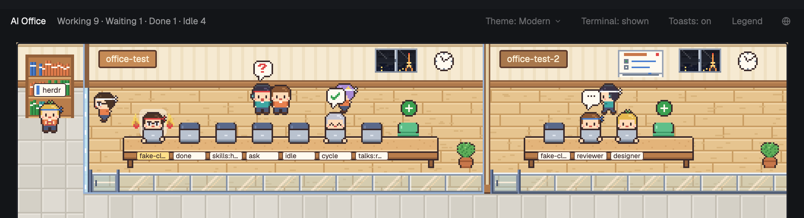

# Herdr AI Office

English | [日本語](README.ja.md)

A mod and layout for [Herdr](https://herdr.dev) (herdr-app) that shows your spaces as rooms and your AI agents as characters in a Kairosoft-style pixel-art office. All the art was drawn for this repository.



- Characters act out their agent's state: typing while it works, walking to the library's bookshelf while it looks things up, raising a hand for a question or permission, a ✓ when it's done, wandering around when it's idle
- Click a character to show that agent's terminal. It's the real terminal, so you can talk to the agent right there
- Hire an agent at a free seat, and make a room (space) with the "+ Room" door
- Plans and .md files the agents write go up on their room's whiteboard; the skills you can use stand on the library's bookshelf
- The wall clock and the view out of the window follow the time and weather of a city you pick
- English and Japanese

## Install

You need herdr-app (with the `hc` that comes with it) and `jq`. Start herdr-app once first (the keys.json the keys go into is made then).

The easiest way is to ask an agent in Herdr (Claude Code or the like):

```text
Add the Herdr layout at https://github.com/thundermiracle/herdr-ai-office, and register its Claude Code hook
```

The agent reads Herdr's guide (`~/.config/herdr-app/AGENTS.md`) and [RECIPE.md](RECIPE.md), tells you first what the office reaches beyond Herdr, copies the layout and the mods, adds the keys (asking before replacing one you use), registers the hook and switches to the layout. Ask the same way to update or remove it.

To install by hand:

```sh
git clone https://github.com/thundermiracle/herdr-ai-office.git
cd herdr-ai-office
scripts/install.sh                            # copies the mods and layouts, registers the hook, adds the keys, checks
herdr-app do layout.switch --name ai-office   # switch to the office layout (ctrl-shift-l works too)
```

- To update: `git pull && scripts/install.sh`
- If something doesn't work, run `scripts/doctor.sh`; an NG line says how to fix it (it changes no settings; to check, it makes a hidden throwaway terminal and removes it)
- `--no-hook`: don't register the hook (the doctor at the end then shows the hook as NG, and `install.sh` ends with a failure)
- `--no-keys`: don't add the keys to keys.json (no ⌘. and ⌘⇧.)
- `--no-hook` and `--no-keys` only skip adding; they don't remove what an earlier install added (see Uninstall for that)

### The Claude Code hook

The hook (`hook/claude-office-act.sh` in the mod) tells the office when Claude Code looks things up, uses a skill, writes a .md file or talks to another agent; without it, rooms, characters, typing, raised hands and ✓ still work. It's copied with the mod, so moving or deleting the repository doesn't break it.

```sh
bash ~/.config/herdr-app/mods/ai-office/hook/register.sh add      # register it (install.sh runs this too)
bash ~/.config/herdr-app/mods/ai-office/hook/register.sh status   # is it registered?
```

- Registering needs `~/.claude/settings.json` (if it's missing: `echo '{}' > ~/.claude/settings.json`)
- When it's newly registered, restart the Claude Code sessions that are running (Claude Code reads hooks when it starts)

### What the office touches

Herdr mods are trusted code, so here is what this one does besides drawing:

- **Network**: fetches the weather for the window from [Open-Meteo](https://open-meteo.com/) (no key; it sends only the chosen city's latitude and longitude)
- **Changed when installing**: `mods/` and `layouts/` in `~/.config/herdr-app/`, `~/.claude/settings.json` (the hook), and `~/.config/herdr-app/keys.json` (two keys; the original is kept as `keys.json.before-ai-office`, and once the file is changed, Herdr no longer adds its new default keys to it when it updates)
- **Written by the hook**: labels (`office.*`) on the terminal Claude Code runs in, and small records in `$TMPDIR`
- **Read** (never written): skills (`~/.claude/skills/`, plugins, `~/.codex/skills/`, `.claude/skills/` in each space's folder), model and effort (`~/.codex/config.toml`, `~/.cache/claude-model/`, `~/.cache/claude-effort/`), the plans and .md files the agents wrote, and themes you add
- **Runs**: `sh` (to read the OS language), `herdr-app status`, `git rev-parse`, and `hc read` and `hc keys` (to answer questions)

### Uninstall

Ask an agent to remove AI Office, or do it by hand (switch to another layout first):

```sh
herdr-app do layout.switch --name main                            # Herdr's default layout
bash ~/.config/herdr-app/mods/ai-office/hook/register.sh remove   # remove the hook (before deleting the mod)
scripts/keys.sh remove                                            # in the repository: remove the office's keys (also matching ones you had before)
rm -r ~/.config/herdr-app/mods/ai-office ~/.config/herdr-app/mods/ai-office-*
rm ~/.config/herdr-app/layouts/ai-office.json
```

## Use

The office is on the left, and the terminal of the agent you click is on the right. The buttons in the top bar pick the theme, show or hide the terminal on the right, turn the toasts at the bottom right on or off, show the legend (how to tell the characters apart) and pick the language.

| Where | What happens |
|---|---|
| A character, desk nameplate or laptop | Shows that agent's terminal (over the office while the terminal on the right is hidden) |
| Right-click a laptop | That tab's menu (Rename, Close). The ai-office layout has no tab bar, so this is where tabs are managed |
| A question's "?" | A dialog with the question and its choices; picking one sends the answer to the terminal |
| The "+" over a free chair | Starts the agent you pick in a new tab of that room |
| The "+ Room" door | Pick a folder to make a new space |
| A room's nameplate on the wall | The room's menu (Rename, Close and so on). Drag a room's back wall to reorder the rooms |
| A whiteboard | Read the plans and .md files the room's agents wrote |
| The library's bookshelf | The skills you can use, and what each one says |
| The wall clock | Pick the city (the clock, the sky and the weather follow it) |

- To open the office as a floating window over another layout: `herdr-app do mod.open --name ai-office` (again to close). You can also add an "Office" button to your own layout ([docs/internals.md](docs/internals.md), in Japanese)
- `scripts/demo.sh start` makes a demo with fake agents (no AI involved; needs `python3`; `stop` removes it; your screen moves to the demo while it's made)

### Keys

| Key | What it does |
|---|---|
| ⌘. (Command + period) | Closes the terminal shown over the office (Esc goes to the agent, so it can't close it) |
| ⌘⇧. (Command + Shift + period) | Opens the last agent you opened from the office again (ai-office layout only) |

`install.sh` adds both to Herdr's keys.json (`scripts/keys.sh status` shows whether they're there).

## Language

The office is in English and Japanese. It starts in the OS language (English for any other language), and the globe button in the top bar switches it (so do `herdr-app do ai-office.lang-en`, `lang-ja` and `lang-auto`). The tab and room menus and the toasts stay in English like Herdr's own, and `install.sh`, `doctor.sh` and the like print Japanese only.

To add a language, add a table with the same keys as `en` to `TEXT` in `mods/ai-office/text.js` and in each other mod (`mods/ai-office-*/main.js`), and the language's own name for itself to `LANGS` in `text.js`. `bun test` checks that the tables in `text.js` have every sentence English has (not the other mods' tables). `test/text.test.js` assumes exactly English and Japanese, so update it too.

## Themes

Pick one with Theme in the top bar. Two come with the office: Modern (rooms with glass walls) and Japanese (tatami rooms with shoji).

### Adding a theme

1. Copy a bundled theme (such as `mods/ai-office/themes/modern/`) to `~/.config/herdr-app/ai-office-themes/<name>/` (`install.sh` leaves it alone; it wins over a bundled theme of the same name)
2. Change the PNGs and `theme.json` (draw PNGs at 4 px per art px)
3. Check it with `bun scripts/check-theme.js <folder>` (it says why a theme can't be used; needs [bun](https://bun.sh)), then reopen Herdr (the office reads themes when it starts)

<details>
<summary>The fields of theme.json</summary>

```jsonc
// mods/ai-office/themes/modern/theme.json (all numbers in art px; the office draws 1 art px as 2 logical px)
{
  "label": { "en": "Modern", "ja": "モダン" },  // the name in "Theme: …"; a plain string works too (per language: the current one, else English)
  "description": { "en": "…", "ja": "…" },      // the tooltip's description (written like label)
  "order": 1,                        // order in the dropdown (smallest first; same order: by name)
  "window": "slide",                 // wall window: slide (two sliding panes), wood (wooden sliding frame), cross (crossed bars); default cross
  "room": {
    "height": 116,         // the height of a row (the rooms and the hall or aisle in front of them)
    "wall": 30,            // the back wall's height (same as the wall image's)
    "lane": 48,            // the aisle behind the desks (where feet go); below the wall, above the chairs (deskBack − 9)
    "deskBack": 62,        // the desks' back edge (desks are 21 tall)
    "box": 100,            // the room frame (the selected room's frame, the drag marks); for a glass room, the glass's bottom
    "corridorY": 112,      // where people walk when they leave the room (feet)
    "wanderFront": null,   // the y range [top, bottom] to wander in front; null for a glass room (inside the room only)
    "rightExit": false,    // whether people also leave by the aisle right of the desks (only rooms open at the front)
    "partitionEnd": 100,   // how far from the back the room's left partition (wall) runs
    "hallSide": "glass",   // the left wall facing the vertical hall: glass or partition
    "shelfY": 8,           // the top of the library's bookshelf
    "decorDy": -2          // moves the wall decorations (window, clock, whiteboard) up or down
  },
  "glass": { "y": 86, "height": 14 },  // the front wall (glass; shoji in the Japanese theme); null for rooms open at the front
  "images": {                          // PNGs in this folder; anything not named uses img/'s default (wall 36, floor, hall)
    "wall": "wall.png",                // the back wall (tiled)
    "corridor": "corridor.png",        // each row's corridor floor (height − box tall)
    "glass": "glass.png",              // one pane of the glass wall (tiled; glass.height tall)
    "door": "glass-door.png",          // the door frame: left post 2, doorway 16, right post 2 (glass.height + 2 tall)
    "doorPanel": "glass-door-panel.png" // the automatic door (16+ wide, up to glass.height tall); without it the door stays open
  },                                   // floor, hall, desks (desk-l, desk-m, desk-r) and chairs (chair, chair-free) can change too
  "colors": {}             // partition and glass wall colors (partition, partitionEdge, partitionFace, partitionBase, sideGlass, sideGlassEdge)
}
```

- The // lines explain; a real theme.json is JSON and can't have comments
- For 1.5× and 2× drawing you can add 6× and 8× PNGs named with `@6x` and `@8x` (otherwise the 4× PNG is stretched and blurs a little)
- Desks are the same size as img/'s (ends 8 x 21, one seat 24 x 21). The chair and the free seat's chair are the same size, at most 24 wide
- A theme changes sizes, the floor, wall, hall, glass, door, desk and chair images, the partition colors and the window frame. How desks are laid out and how people walk stay the same

</details>

## Known limits

- Tested on macOS only (not tried on other systems)
- Library trips, skills and whiteboards show only for Claude Code sessions started after the hook was registered (not for Codex or sub-agents). Talking shows when the sender or the receiver is such a session
- Sub-agents (terminals without a pane, started with `hc run`) aren't in the office yet
- Herdr's CPU use is about 5–8% while the office shows and about 1% while it's hidden
- A Herdr zoom other than 1 blurs the art a little
- The city is one of 19. The weather is a weather model's current value, so it can differ a little from the real sky

More in [docs/internals.md](docs/internals.md) (in Japanese).

## Development

```sh
bun test                                    # scene.js, text.js (languages), reading question screens
test/hook-test.sh                           # the hook (in throwaway terminals that don't show in herdr-app)
test/ask-test.sh                            # answering questions (with a fake asker)
test/keys-test.sh                           # adding and removing keys (on a keys.json in a temp folder)
scripts/sync.sh                             # copy the mods and layouts and run herdr-app check (Herdr reloads them)
uv run --with pillow scripts/build-art.py   # redraw the art
```

GitHub Actions (`.github/workflows/ci.yml`) runs `bun test`, `test/keys-test.sh` and a syntax check of the scripts, mods and JSON files on macOS for every push to main and every pull request. `test/hook-test.sh` and `test/ask-test.sh` need herdr-app running, so run them yourself.

`mods/ai-office/` is the office (`scene.js` only computes, `main.js` draws, `text.js` holds the sentences, `hook/` is the Claude Code hook), and `mods/ai-office-*/` are the dialogs and menus it opens. How it works and notes for development are in [docs/internals.md](docs/internals.md) (in Japanese).

## License

MIT ([LICENSE](LICENSE)), except `mods/ai-office-toast/main.js` and `mods/ai-office-tab/main.js`, which are derived from the toast and menu mods that ship with Herdr and stay under the Apache License 2.0 ([LICENSE-APACHE](LICENSE-APACHE), [NOTICE](NOTICE)).

Weather data by [Open-Meteo.com](https://open-meteo.com/) (the data is CC BY 4.0; the free API is for non-commercial use).
