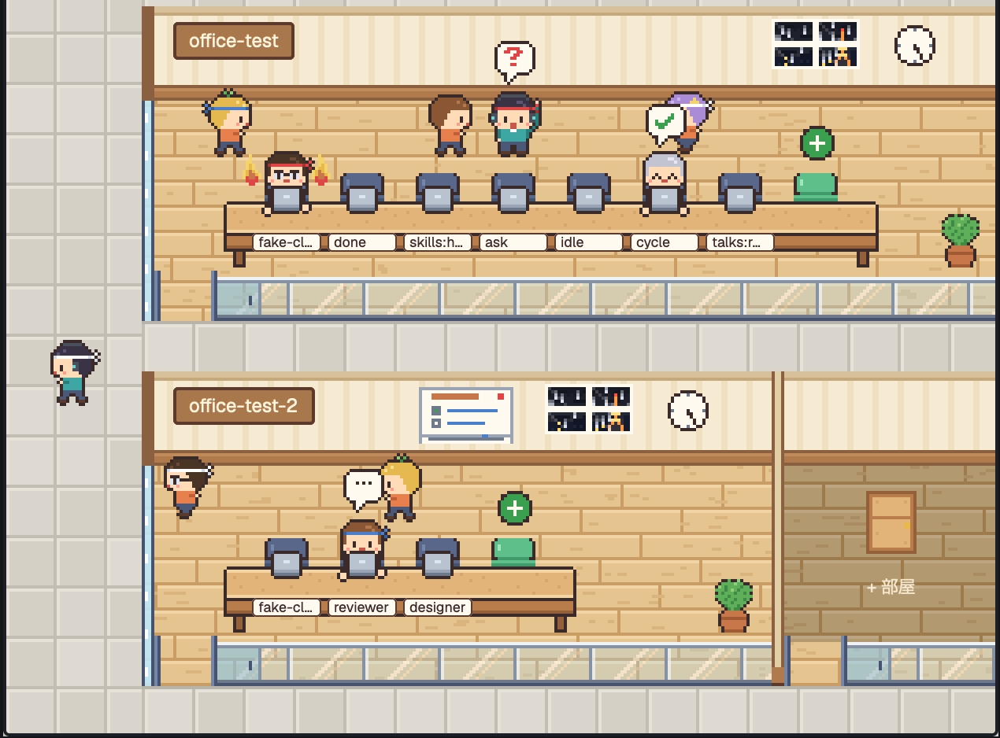

# herdr AI Office

herdr-app のワークスペースを部屋に、AI エージェントをキャラクターにして、
カイロソフト風のドット絵オフィスで見せる mod（PoC）。絵はすべてこのリポジトリで描いたオリジナル。



- 1 つのスペース = 1 つの部屋。真ん中の長い机はエージェントが増えると伸び、部屋も広がる
- 1 つのエージェント = 1 人のキャラクター。状態で動きが変わる（下の表）
- 机にはいつも空いた席が 1 つあり、クリックするとその部屋にエージェントを雇える

進み具合と、作りながら分かったこと（スパイクの計測など）は [TODO.md](TODO.md)。

## 使い方

```sh
scripts/sync.sh                                  # mods/ と layouts/ を ~/.config/herdr-app にコピー
herdr-app do layout.switch --name ai-office      # オフィスのレイアウトにする（ctrl-shift-l でも切り替わる）
herdr-app do layout.switch --name main-dots      # 元に戻す
herdr-app do mod.open --name ai-office           # 今のレイアウトの上に、浮いた窓で開く（もう一度で閉じる）
scripts/demo.sh start                            # 見本: 偽エージェント 6 人のスペース「office-test」（AI は使わない。model と effort もばらばら）
scripts/demo.sh stop                             # 見本を消す
```

`ai-office` レイアウトは、左がオフィス、右がクリックしたエージェントのターミナル。
見本は質問や完了を報告するので、herdr-app の通知音とトーストが出る（全部を順に回る 1 人は 40 秒ごとに質問する）。

## 状態と動き

| エージェントの状態 | キャラの動き |
|---|---|
| working（編集・コマンド） | 席でノート PC をタイピング |
| working ＋ `office.act=read`（Read / Grep / Web 検索） | 本棚まで歩いて本を読む |
| blocked（承認・質問待ち） | 席の後ろで手を挙げる。質問は「?」、許可待ちは「!」 |
| done（見ていない間に完了） | 席で「✓」。herdr-app で一度見ると idle になる |
| idle | 立ってうろうろ（机の奥の通路と手前の床） |

見た目は AI ごとに 1 人（Claude Code は橙の上着、Codex は青緑の上着とヘッドホン、ほかは紫）で、
model と effort で見分ける（オフィスの右上の「凡例」にも出る）:

| model（髪の色と小物） | effort（鉢巻き） |
|---|---|
| opus: こげ茶の髪・眼鏡・ネクタイ | low: なし |
| sonnet: 茶色の髪（小物なし。model が分からないときも） | medium: 青 |
| haiku: 金髪・若葉 | high: 白 |
| fable: 薄紫の髪・星のピン | xhigh: 赤 |
| Codex: 黒髪・ヘッドホン | max: 赤、作業中は両側に炎 |

model と effort は、Claude なら statusLine の effort-recorder が書くキャッシュ（`~/.cache/claude-model/<セッション>`・
`~/.cache/claude-effort/<セッション>`。セッションはターミナルの `resume.id` ラベル）を 10 秒ごとに読み、
なければ起動引数（`--model`・`--effort`）。Codex は起動引数（`-m`・`-c model_reasoning_effort=`）か `~/.codex/config.toml`。
同じ model と effort なら同じ見た目になるので、誰かはマウスを乗せたときの表示（場所・状態）で見分ける。

## クリック

| どこ | 何が起きるか |
|---|---|
| キャラクター | そのエージェントを表示（`agent.focus`。`ai-office` レイアウトなら右に出る） |
| 空いた椅子・その席のノート PC | 「雇う」ポップアップ。選んだエージェントを、その部屋のスペースの新しいタブで起動 |
| 壁の名札 | そのスペースへ（`space.select`） |
| 「+ 部屋」のドア | フォルダを選んで、新しいスペース（部屋）を作る（この Mac だけ） |

## 本棚（調べ物中）のフック

状態（OSC 7501）だけでは「調べ物中」かどうか分からないので、Claude Code のフック
`hooks/claude-office-act.sh` が、これから使うツールをターミナルのラベル `office.act` に書く
（Read / Grep / Glob / Web 検索 → `read`、編集 → `edit`、Bash → `run`、ほか・ターンの始めと終わりは消す）。
herdr-app のターミナルの中（`HC_TERMINAL_ID` がある）だけで動き、1 回 30〜40ms で、`hc` の終わりは待たない。

```sh
hooks/register.sh status   # ~/.claude/settings.json に登録されているか
hooks/register.sh add      # 登録（PreToolUse・UserPromptSubmit・Stop・SessionEnd）
hooks/register.sh remove   # このフックだけ外す（ほかのフックはそのまま）
```

今は PoC として ~/.claude/settings.json に直接登録している。あとで外すか、chezmoi
（dotfiles の `dot_claude/modify_settings.json`）に移す。Claude Code は起動したときのフックを使うので、
登録より前から動いている Claude には効かない。Codex にはまだない（座る・うろうろ・挙手だけ）。

## 中身

| 場所 | 何か |
|---|---|
| `mods/ai-office/` | mod 本体。`scene.js` は計算だけ（herdr も gpui-kit も import しない）、`main.js` が描く |
| `mods/ai-office-hire/` | 空いた席をクリックすると出る「雇う」ポップアップ |
| `layouts/ai-office.json` | オフィスと、選んだエージェントのターミナルを並べたレイアウト |
| `scripts/build-art.py` | ドット絵（文字の格子で描き、4 倍の PNG に書き出す）。`tmp/art-preview.png` に一覧と部屋の見本 |
| `hooks/` | Claude Code のフックと、その登録・削除 |
| `scripts/fake-agent.sh`、`scripts/demo.sh` | AI を使わずに状態を報告する偽エージェントと、それを 6 人並べた見本 |
| `scripts/sync.sh` | mod とレイアウトを ~/.config/herdr-app にコピーして `herdr-app check` |
| `spike/` | 描画方針を決めたときの確認用 mod（アニメ画像・にじみ・アニメの負荷） |
| `test/` | `bun test`（scene.js）と `test/hook-test.sh`（フック。使い捨てのターミナルで試す） |

## 開発

```sh
uv run --with pillow scripts/build-art.py   # 絵を作り直す（mods/ai-office/img/ と tmp/art-preview.png）
bun test                                    # scene.js
test/hook-test.sh                           # フック
scripts/sync.sh                             # コピーして check（herdr-app は自動で読み直す）
herdr-app shot tmp/shot.png                 # 今の画面を撮って確かめる
```

herdr-app はコピー先の変更を見て mod を読み直す。シンボリックリンクにしないのは、
リンク先の変更を herdr-app が検知できないことがあるため。Herdr の窓が最小化・別のデスクトップ・
完全に隠れていると描画が止まり、`herdr-app shot` も古い画面のままになる。

## 分かっている制限

- アニメ GIF / WebP は mod では動かないので、1 本のタイマーでコマを送っている。オフィスを開いている間、
  Herdr の CPU は窓がアクティブなとき約 8%（6fps）。後ろにあるときは 2fps に落とす。
  ネイティブのアニメは 1 つで約 20% なので使っていない
- 絵は 4 倍の PNG を 2 倍で描いてにじまないようにしているので、herdr-app のズームを 1 以外にすると少しにじむ。
  画面が広くても部屋は大きくならない（大きくするには 6 倍の絵を作って SCALE を 3 にする）
- クリックの動作（フォーカス・雇う・名札・ドア）は自動テストがなく、手で確かめる
- サブエージェント（`hc run` で起動されたペインのないターミナル）はまだ出ない
- フックのパスはこのリポジトリを指しているので、リポジトリを動かしたら `hooks/register.sh remove` → `add` し直す

## 次の一手

- chezmoi で入れる（`.chezmoiexternal.toml` でこのリポジトリを取り込み、フックは `dot_claude/modify_settings.json` へ）
- 大きく描くモード（6 倍の絵）、Codex の本棚、サブエージェントを「バイト」の小さいキャラで出す
- カイロソフトっぽい演出（作業の数字がポンと出る、部屋の模様替え）
- herdr.dev/mods に出す（`RECIPE.md` と `preview.png`、トピック `herdr-mod`）
