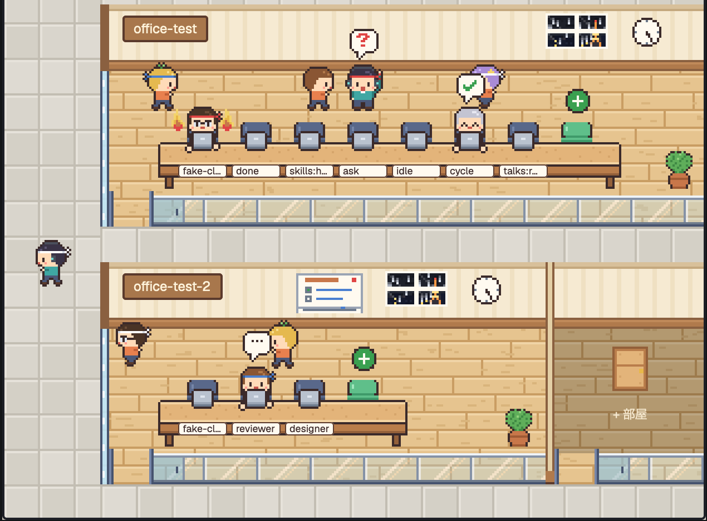

# AI Office

Your Herdr spaces become rooms of a pixel-art office and your AI agents become characters at their desks. A character types while
its agent works, walks to the library's bookshelf while it reads, raises a hand when it asks a question or waits for permission,
shows a ✓ when it finishes and wanders when idle. Clicking a character shows that agent's real terminal, beside the office or over
it. Plans and .md files the agents write hang on their room's whiteboard, the skills they can use stand on the bookshelf, and the
wall clock and the view out of the window follow the time and weather of a city you pick.

## What you see

The `ai-office` layout is a row with a 1px `border` divider on the `canvas` background:

- **Left, the office** (weight 3, at least 440px): the `ai-office` mod.
  - **Top bar:** on the left, the counts (working, waiting, done, idle; while a room is dragged, what dropping it will do). On the
    right: "Theme: …", "Terminal: shown / hidden", "Toasts: on / off", "Legend" and a globe icon (the language).
  - **Floor:** pixel art drawn at 4px per art px and shown at 2 logical px per art px (1.5× and 2× with `@6x` and `@8x` PNGs when
    the panel is wide enough). A vertical hall 44 art px wide runs down the left, with the library's bookshelf at its top. To its
    right, one room per space, side by side, wrapping into rows of equal width.
  - **A room** (Modern theme: rows 116 art px high): a back wall 30 art px high with a nameplate (the space's name, shortened to
    16 half-width characters), a whiteboard (only when the room's agents wrote a plan or a .md file), a window and a clock; a long
    desk with one laptop per agent and one free seat (a green chair with a bobbing "+"); a plant. Each agent's desk has a nameplate
    with its tab's name. Rooms are at least 160 art px wide; with a whiteboard, at least 200.
  - **The "+ Room" door:** an empty room 72 art px wide after the last room.
- **Right, the agent** (weight 2, at least 360px, padding 8): the focused agent's terminal (`"content": {"agent": "focused"}`).

## How it behaves

| Agent status | What its character does |
|---|---|
| working | Types at its laptop |
| working, while the hook reports a read (Read, Grep, Glob, web search) | Walks down the hall to the library and reads a book |
| used a skill (hook) | Hurries to the library (60 art px/s), pulls out that skill's book, reads it for 5 s and hurries back |
| sent another agent a message with `hc send` (hook) | Hurries to the receiver, they talk in turns for 4.8 s (its tag shows the first 14 characters of the message, theirs "…"), then it hurries back |
| blocked | Raises a hand behind its chair: "?" for a question, "!" for permission |
| not reported yet (starting, or stopped at a check before it starts) | Stands behind its chair; after 3 s without a report, raises a hand with a "!" |
| done (finished while you weren't looking) | A "✓" at its desk |
| idle | Wanders inside its room |

Walking is 14 art px/s. Frames step on one timer: 4 fps while the window is active, 2 fps behind other windows, 8 fps while
someone is running. Each AI has its own look (Claude Code: an orange jacket; Codex: a teal jacket and headphones; any other agent: a
purple jacket). Hair and accessories tell the model (opus: dark brown hair, glasses, a tie; sonnet: brown hair, also when the model
is unknown; haiku: blond hair, a green leaf; fable: lilac hair, a star pin; Codex: black hair). A headband tells the effort (low:
none; medium: blue; high: white; xhigh: red; max: red, with flames on both sides while working). The Legend button shows all of it.

Clicks:

| Where | What happens |
|---|---|
| A character, its desk nameplate or its laptop | Shows that agent's terminal: `agent.focus` while the terminal on the right is shown, `terminal.peek` over the office while it is hidden |
| Right-click a laptop | That tab's menu: Rename, Close |
| A "?" | A dialog with the question and its choices, read from the terminal's screen; picking one sends the keys (↑↓ and Enter, 1–9, Esc closes), question after question up to the final review |
| The "+" over a free chair | A list of the agents Herdr knows; the one picked starts in a new tab of that room's space (`tab.new`) |
| The "+ Room" door | Pick a folder; a new space starts there (`space.new`) |
| A room's nameplate | Selects the space and opens its menu: Rename, worktrees, Close |
| Drag a room's back wall | Moves that space before or after the room it's dropped on (`space.move`) |
| A whiteboard | The room's plans and .md files as Markdown, a list on the left when there are several; read again every 2 s while open |
| The bookshelf | The skills, colored by source (blue: `~/.claude/skills`; red: `.claude/skills` in a space's folder; orange: synced from claude.ai; green: plugins; teal: Codex), up to 39 on the shelf (3 shelves of 13); click one to read its `SKILL.md` |
| The wall clock | Pick one of 19 cities; the clock, the sky and the weather follow it |
| A window (hover) | That city's time, weather and temperature |
| Theme / Terminal / Toasts / Legend / globe | Pick the theme; `layout.toggle` the `agent` block; stop or allow the bottom-right toasts; show the legend; pick the language (Match the OS, English, 日本語) |

Hovering a character, its laptop or its desk nameplate lights all three and shows a name tag over its head; the agents of the tab
on screen stay lit. Keys: ⌘. closes a peeked terminal (Esc goes to the agent), and ⌘⇧. opens the last agent opened from the office
again (it does nothing while something is shown over the office). `herdr-app do ai-office.toasts-off` and `toasts-on` switch the
toasts; `sky-<weather or time>` tries out the window. The sky follows the sun's height at the chosen city (night, twilight, dawn,
day, dusk), with that city's landmark in the view; the weather (clear, cloudy, fog, rain, snow, thunderstorm) comes from Open-Meteo
every 15 minutes while the office is visible.

## Built from

- **Layout** `layouts/ai-office.json`: root `row` with `"toast": "ai-office-toast"` → block `office` (`{"mod": "ai-office", "props":
  {"block": "office"}}`, weight 3, min 440) and block `agent` (`{"agent": "focused"}`, weight 2, min 360, padding 8).
- **Mods** (each popup or dialog is its own mod, since a mod's `mod.json` describes one overlay):

  | Mod | Role | Overlay |
  |---|---|---|
  | `ai-office` | The office (`main.js` draws, `scene.js` computes rooms, seats, paths and behaviors without importing herdr, `text.js` holds the sentences per language, `themes/` the bundled themes, `img/` the art, `hook/` the Claude Code hook) | window 920×640 (for `mod.open`) |
  | `ai-office-ask` | Answering a question | dialog 0.65×0.8 |
  | `ai-office-docs` | The whiteboard | dialog 0.65×0.8 |
  | `ai-office-hire` | Picking an agent to hire | popup 240×320 |
  | `ai-office-legend` | The legend | popup 300×420 |
  | `ai-office-pick` | Dropdowns (theme, city, language) | popup 320×420 |
  | `ai-office-skills` | The skill list | popup 400×520 |
  | `ai-office-skill` | One skill's contents | dialog 760×0.8 |
  | `ai-office-tab` | Tab and room menus (from Herdr's shipped `menu` mod) | popup 200×90 |
  | `ai-office-toast` | Toasts that close at once while the office's switch is off (from Herdr's shipped `toast` mod) | none |
  | `ai-office-toggle` | Optional: an "Office" button for your own layout (`layout.toggle` on a block given in props) | none |
- **herdr functions:** `spaces`, `agents`, `terminals`, `panes`, `layout`, `props`, `theme`, `window`, `shared` and `setShared`,
  `nextCommand`, `knownAgents`, `keys`, `openOverlay`, `pickFolder`, `readTextFile`, `exec`, `hc`, `run` (`agent.focus`,
  `terminal.peek`, `tab.new`, `tab.rename`, `tab.close`, `space.new`, `space.select`, `space.rename`, `space.close`,
  `space.move`, `layout.toggle`, `layout.show`).
- **Shared state:** `ai-office.theme`, `.place`, `.weather`, `.toasts`, `.lang`, `.os-lang`, `.last`, `.seen`, `.skills`,
  `.error`.
- **Keys** (`keys.json`): `"terminal": {"cmd-.": "overlay.close"}` and `"layout:ai-office": {"cmd-shift-.": "ai-office.open-last"}`.
- **Programs and network:** `sh` once at start for the OS language (`defaults read -g AppleLanguages`, else `LC_ALL`,
  `LC_MESSAGES`, `LANG`); `herdr-app status` when ⌘⇧. is pressed; `git rev-parse` when a room's menu opens; `hc read` and
  `hc keys` when answering a question; `https://api.open-meteo.com/v1/forecast` with the city's latitude and longitude, no key.
- **Files read:** `~/.claude/skills`, plugin skills and commands (where `~/.claude/plugins/installed_plugins.json` points),
  `~/.codex/skills`, `.claude/skills` in each space's folder, `~/.codex/config.toml`, `~/.cache/claude-model/<session>` and
  `~/.cache/claude-effort/<session>` if something writes them (the session is the terminal's `resume.id` label), the plans and
  .md files named in terminal labels, and themes in `~/.config/herdr-app/ai-office-themes/<name>/`.
- **The Claude Code hook** `mods/ai-office/hook/claude-office-act.sh` (with `md-writes.jq` beside it): registered in
  `~/.claude/settings.json` for PreToolUse (matcher `*`), UserPromptSubmit, Stop and SessionEnd as `sh "<path>"` by
  `hook/register.sh add`. It writes terminal labels with `hc label`: `office.act` (read, edit, run), `office.skill` and
  `office.skill_at`, `office.plan`, `office.docs` (up to 8 project .md files and 4 in temp folders), `office.talk`,
  `office.talk_at`, `office.talk_text`, `office.heard`, `office.heard_at`, `office.heard_text`. It runs only inside Herdr's
  terminals (`HC_TERMINAL_ID`) and takes 30–40 ms a call.
- **Art:** every PNG is original, drawn as character grids by `scripts/build-art.py` and written at 4×, 6× and 8×. A theme is a
  folder with a `theme.json` (room sizes, image names, colors and window frame) and its PNGs; Modern and Japanese (`classic`) ship
  in `mods/ai-office/themes/`.

## Watch out

- The hook is outside Herdr's home. After copying the files, ask the person before running
  `bash ~/.config/herdr-app/mods/ai-office/hook/register.sh add`, then tell them to restart running Claude Code sessions. It needs
  `~/.claude/settings.json` (`{}` is enough). Register the copy under `~/.config/herdr-app/mods/`, not a clone, so moving or
  deleting the clone doesn't break it. Without the hook, rooms, characters, typing, raised hands and ✓ still work; library trips,
  skills, whiteboards and talking don't.
- If the mods are renamed on install, also rename the `mods/ai-office/...` paths inside them (images, icons, themes) and the
  `ai-office-*` names `ai-office` opens.
- To update, when the person asks for an update, replace `layouts/ai-office.json` and every `mods/ai-office*` folder in place
  (don't add a renamed copy), then run `register.sh add` again (it changes nothing when the hook is already there).
- Esc inside a peeked terminal goes to the agent (it interrupts Claude Code), so closing needs ⌘. in the `terminal` section of
  keys.json; ⌘Esc never reaches keys.json there. Any edit makes keys.json the person's own, and Herdr stops adding its new default
  shortcuts to it, so merge only these two keys and ask before replacing one in use.
- Mods can't play animated GIF or WebP and can't import across mod folders. Keep the frame timer at 4 fps: 6 fps costs about 15%
  CPU in a side column. Herdr's CPU is about 5–8% while the office shows, about 1% while hidden.
- There is no `Intl` in mods, so time zones and summer time (US, EU and Australian rules) are computed by hand.
- `setShared` re-renders every mod; `herdr-app check` runs with empty shared state (so it renders English).
- A Herdr zoom other than 1 blurs the art. Only tested on macOS. Sub-agents (`hc run` terminals without a pane) aren't shown.
- Open-Meteo's free API is for non-commercial use and needs the attribution "Weather data by Open-Meteo.com".

## Done when

- `herdr-app check` passes for every `ai-office*` mod.
- `herdr-app do layout.switch --name ai-office` shows the office on the left and the focused agent's terminal on the right: one
  room per space, one character per agent, and a free seat with a "+" in every room.
- Clicking a character focuses its terminal; with "Terminal: hidden", it shows the terminal over the office, ⌘. closes it and ⌘⇧.
  opens it again.
- A working agent types, a blocked one raises a hand with "?" or "!", and one that finished unseen shows ✓.
- With the hook registered and Claude Code restarted, a Read sends its character to the library, writing a .md file hangs a
  whiteboard in its room, and `hc send` makes it walk over and talk.
- Theme switches between Modern and Japanese, the globe between English and 日本語, and the clock changes the city and the sky.
